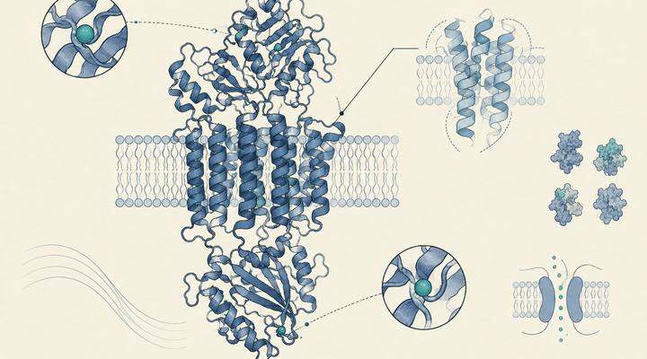
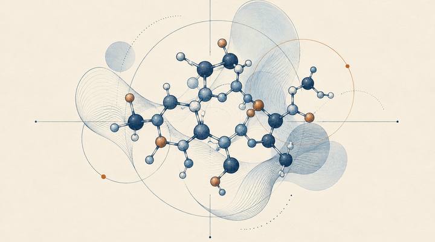
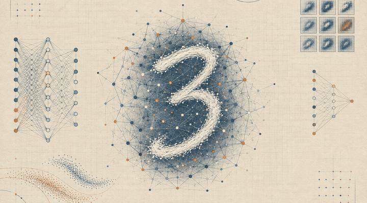

<picture><source media="(prefers-color-scheme: dark)" srcset="./assets/editorial/header-dark.svg"><source media="(prefers-color-scheme: light)" srcset="./assets/editorial/header-light.svg"></picture>

<a href="#selected-work">Selected work</a> &nbsp; · &nbsp; <a href="#expertise">Expertise</a> &nbsp; · &nbsp; <a href="#contact">Contact</a>

I build across software and machine learning, with a particular interest in research tools, biological data, and the systems that bring them together.

### Expertise

**Research tools** — Literature discovery & visual exploration  
**Applied ML** — Biological data & model evaluation  
**Software systems** — Mobile clients, APIs & data pipelines

## Selected work

<table><tr><td width="50%" valign="top">
<a href="https://github.com/moftahykh/papergraph"><picture><source media="(prefers-color-scheme: dark)" srcset="./assets/editorial/papergraph-dark.svg"><source media="(prefers-color-scheme: light)" srcset="./assets/editorial/papergraph-light.svg"></picture></a> 
01 / RESEARCH DISCOVERY <b>PaperGraph</b> 
Explore the citations and related research around a paper in an interactive graph.  
Flutter · FastAPI · PostgreSQL  
<a href="https://github.com/moftahykh/papergraph">Explore project →</a>
</td><td width="50%" valign="top">
<a href="https://github.com/moftahykh/cftr-pathogenicity-classifier"><picture><source media="(prefers-color-scheme: dark)" srcset="./assets/editorial/cftr-dark.svg"><source media="(prefers-color-scheme: light)" srcset="./assets/editorial/cftr-light.svg"></picture></a> 
02 / COMPUTATIONAL BIOLOGY <b>CFTR Pathogenicity Classifier</b> 
Experimental variant classification using protein structure and grouped evaluation.  
Python · AlphaFold · scikit-learn  
<a href="https://github.com/moftahykh/cftr-pathogenicity-classifier">Explore project →</a>
</td></tr><tr><td width="50%" valign="top">
<a href="https://github.com/moftahykh/MoleculeNet-HIV-Prediction"><picture><source media="(prefers-color-scheme: dark)" srcset="./assets/editorial/molecule-dark.svg"><source media="(prefers-color-scheme: light)" srcset="./assets/editorial/molecule-light.svg"></picture></a> 
03 / MOLECULAR ML <b>MoleculeNet HIV Prediction</b> 
Molecular screening benchmark with 0.8525 test ROC-AUC and 29.8% active-compound recall.  
Python · RDKit · XGBoost  
<a href="https://github.com/moftahykh/MoleculeNet-HIV-Prediction">Explore project →</a>
</td><td width="50%" valign="top">
<a href="https://github.com/moftahykh/mnist-nn"><picture><source media="(prefers-color-scheme: dark)" srcset="./assets/editorial/neural-dark.svg"><source media="(prefers-color-scheme: light)" srcset="./assets/editorial/neural-light.svg"></picture></a> 
04 / NEURAL NETWORKS <b>NeuralCanvas</b> 
A neural network trained from scratch, with digit recognition running in the browser.  
NumPy · JavaScript · MNIST  
<a href="https://github.com/moftahykh/mnist-nn">Explore project →</a>
</td></tr></table>

Project artwork is conceptual, not scientific data or application screenshots.

### What I work on

Research discovery, biological data and software—from data pipelines through to interfaces.

### Contact

Open to collaboration and research. [Email me →](mailto:khalil.moftah@gmail.com)

## Activity

The contribution snake

<picture>
  <source media="(prefers-color-scheme: dark)" srcset="https://raw.githubusercontent.com/moftahykh/moftahykh/output/github-contribution-grid-snake-dark.svg">
  <source media="(prefers-color-scheme: light)" srcset="https://raw.githubusercontent.com/moftahykh/moftahykh/output/github-contribution-grid-snake.svg">
  
</picture>
